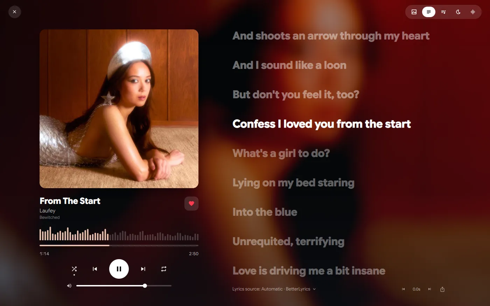

<div align="center">


# Senada

### Press play. Make it your space.

A free, open-source music player for **Windows & Linux**.<br>
Explore YouTube Music, sing along with synced lyrics, and bring your favorite playlists.<br>
**No account. No ads. Just open it and listen.**

<p><i>Ruang untuk musikmu. Gratis, tanpa akun, tanpa iklan.</i></p>

[](https://github.com/Zeeynrs/Senada/releases/latest)
[](https://github.com/Zeeynrs/Senada/stargazers)
[](LICENSE)


[](https://github.com/Zeeynrs/Senada/releases/latest)
&nbsp;
[](#en-linux)

**[English](#english)** · **[Bahasa Indonesia](#bahasa-indonesia)** · **[Screenshots](#gallery)** · **[Complete guide](docs/GUIDE.md)**

<br>


<p><sub>Your library. Your lyrics. A player that follows the color of every song.</sub></p>

</div>

<a id="english"></a>

## Your next favorite way to listen

For the playlist you work to, the album you know by heart, and the song you just discovered. Senada brings music, lyrics and your own collection together in one desktop app.

<a id="en-features"></a>

| What you love | How Senada makes it yours |
| :--- | :--- |
| **🎧 Open and listen** | Search songs, artists, albums and playlists from YouTube Music without creating an account. |
| **🎤 Catch every word** | Follow synced lyrics, with word-by-word karaoke when available. Add romanization or translation, or turn favorite lines into a shareable image. |
| **📥 Keep your playlists close** | Import public Spotify and YouTube Music playlists or albums. Spotify tracks are matched to versions on YouTube Music. |
| **🏝️ Stay in the flow** | Keep controls and lyrics within reach in the Dynamic Island mini player while you work. Press `Ctrl+M` to open it. |
| **🎨 Set the mood** | Pick light or dark, choose from 12 accent colors, or let the cover art color your player. Go full screen with visualizer, vinyl, poster or cinema views. |
| **💾 Listen your way** | Save songs for offline listening, add your local music files, and keep your library on your computer. Back up and restore it when you move. |

**And for the long listening sessions:** equalizer, crossfade, volume normalization, skip silence, sleep timer, media keys, optional Discord presence, listening stats and a phone remote on the same Wi-Fi.

[Explore every feature →](docs/GUIDE.md#en-features)

<a id="en-windows"></a>

## Get Senada

### Windows 10 / 11

1. Download **`Senada-Setup-<version>.exe`** from the [latest release](https://github.com/Zeeynrs/Senada/releases/latest).
2. Run the installer and choose **Install for me only**; no admin rights needed.
3. Open **Senada** from the Start menu and search for your first song.

Python and playback tools are included. Senada notifies you when an update is available, and you can install it from the app.

<details>
<summary>Seeing “Windows protected your PC”?</summary>

The installer is not yet signed with a code-signing certificate. After downloading it from this repository's release page, choose **More info → Run anyway** to continue.

</details>

<a id="en-linux"></a>

### Linux

Run the installer in your terminal:

```bash
curl -fsSL https://raw.githubusercontent.com/Zeeynrs/Senada/main/install.sh | bash
```

Then open **Senada** from your app launcher or run `senada`. The installer supports pacman, apt, dnf, zypper, xbps and apk, and sets up dependencies and a desktop entry.

[Manual installation, Arch Linux & uninstall instructions →](docs/GUIDE.md#en-linux)

<a id="en-usage"></a>

### Make yourself at home

1. **Find a favorite.** Press `Ctrl+F` and search for a song, artist or album.
2. **Bring a playlist.** Open **Library → Import playlist** and paste a public Spotify or YouTube Music link.
3. **Make it yours.** Like songs, create playlists, then choose your theme in **Settings → Appearance**.
4. **Settle in.** Open the full-screen player with `Ctrl+L`, or keep things small with `Ctrl+M`.

---

<a id="gallery"></a>

## One player. Your kind of atmosphere.

<table>
  <tr>
    <td width="50%" valign="top">
      
      <p><b>Give the music the whole screen</b><br>Visualizer, vinyl, poster or cinema.<br><i>Bawa suasana lagu ke layar penuh.</i></p>
    </td>
    <td width="50%" valign="top">
      
      <p><b>Let the artwork set the mood</b><br>Glass panels with the album cover behind them.<br><i>Warna dan sampul jadi bagian dari suasana.</i></p>
    </td>
  </tr>
  <tr>
    <td width="50%" valign="top">
      
      <p><b>A color for every mood</b><br>12 accents, or a color that follows the song.<br><i>Pilih warna sendiri, atau ikuti lagunya.</i></p>
    </td>
    <td width="50%" valign="top">
      
      <p><b>From daylight to late nights</b><br>Light and dark themes, including system mode.<br><i>Nyaman dari pagi sampai malam.</i></p>
    </td>
  </tr>
</table>

### A little island for your music

Minimize the app while a song plays and keep listening with controls at the top of your screen. Expand the mini player for lyrics and more controls; leave it alone and it tucks into the edge.

*Musik tetap dekat saat kamu bekerja. Buka pemutar mini untuk kontrol dan lirik, lalu biarkan ia terselip di tepi layar.*

<p align="center">
  
</p>

---

<a id="bahasa-indonesia"></a>

## Musikmu, dengan caramu

Untuk playlist teman kerja, album yang hafal di luar kepala, atau lagu yang baru kamu temukan. **Senada** menyatukan musik dari YouTube Music, lirik, dan koleksi pribadimu dalam satu aplikasi desktop gratis untuk **Windows & Linux**. Buka, cari lagu, lalu putar. Tanpa akun dan tanpa iklan.

[**Unduh untuk Windows**](https://github.com/Zeeynrs/Senada/releases/latest) · [**Pasang di Linux**](#id-linux) · [Lihat tampilan](#gallery) · [Panduan lengkap](docs/GUIDE.md#bahasa-indonesia)

<a id="id-fitur"></a>

### Kenapa kamu akan betah?

| Yang kamu suka | Yang bisa kamu lakukan di Senada |
| :--- | :--- |
| **🎧 Langsung dengarkan** | Jelajahi lagu, artis, album, dan playlist dari YouTube Music tanpa membuat akun. |
| **🎤 Ikut bernyanyi** | Nikmati lirik tersinkron dan karaoke per kata jika tersedia. Tambahkan romanisasi atau terjemahan, lalu bagikan baris favorit sebagai gambar. |
| **📥 Bawa playlist favoritmu** | Impor playlist atau album publik dari Spotify dan YouTube Music. Lagu Spotify dicocokkan dengan versi di YouTube Music. |
| **🏝️ Musik tetap dekat** | Kontrol lagu dan baca lirik lewat pemutar mini Dynamic Island saat bekerja. Buka kapan saja dengan `Ctrl+M`. |
| **🎨 Sesuaikan suasananya** | Pilih tema terang atau gelap, 12 warna aksen, atau warna yang mengikuti sampul lagu. Coba tampilan visualizer, vinyl, poster, dan cinema. |
| **💾 Koleksi tetap di komputermu** | Simpan lagu untuk diputar offline, tambahkan file musik lokal, serta cadangkan dan pulihkan library saat pindah perangkat. |

**Untuk sesi dengar lebih lama:** equalizer, crossfade, penyamaan volume, lewati hening, timer tidur, tombol media, Discord presence opsional, statistik mendengarkan, dan remote HP lewat Wi-Fi yang sama.

<a id="id-windows"></a>

### Mulai di Windows 10 / 11

1. Unduh **`Senada-Setup-<versi>.exe`** dari [rilis terbaru](https://github.com/Zeeynrs/Senada/releases/latest).
2. Jalankan installer dan pilih **Install for me only**; tidak perlu hak admin.
3. Buka **Senada** dari Start menu, cari lagu, lalu nikmati.

Python dan alat pemutar sudah disertakan. Pembaruan tersedia lewat aplikasi.

<details>
<summary>Muncul “Windows protected your PC”?</summary>

Installer belum ditandatangani dengan sertifikat code signing. Setelah mengunduh dari halaman rilis repositori ini, pilih **More info → Run anyway** untuk melanjutkan.

</details>

<a id="id-linux"></a>

### Mulai di Linux

Jalankan di terminal:

```bash
curl -fsSL https://raw.githubusercontent.com/Zeeynrs/Senada/main/install.sh | bash
```

Buka **Senada** dari menu aplikasi atau jalankan `senada`. Installer mendukung pacman, apt, dnf, zypper, xbps, dan apk, serta menyiapkan dependensi dan pintasan aplikasi.

[Instalasi manual, Arch Linux & cara menghapus →](docs/GUIDE.md#id-linux)

<a id="id-cara-pakai"></a>

### Dari lagu pertama ke playlist sendiri

1. **Cari favoritmu.** Tekan `Ctrl+F` untuk mencari lagu, artis, atau album.
2. **Bawa playlist-mu.** Buka **Library → Impor playlist**, lalu tempel link publik Spotify atau YouTube Music.
3. **Atur seleramu.** Sukai lagu, buat playlist, dan pilih tema di **Pengaturan → Tampilan**.
4. **Nikmati suasananya.** Tekan `Ctrl+L` untuk player layar penuh, atau `Ctrl+M` untuk pemutar mini.

---

<a id="en-privacy"></a>
<a id="en-troubleshooting"></a>
<a id="id-privasi"></a>
<a id="id-masalah"></a>

## A few things to know / Sebelum mulai

<details>
<summary><b>Do I need Spotify Premium? / Perlu Spotify Premium?</b></summary>

No. Senada plays audio from YouTube Music. Spotify links are used to read public playlist or album metadata and find matching tracks on YouTube Music; Senada does not play Spotify audio. Private playlists and Spotify Liked Songs cannot be imported directly.

Tidak perlu. Audio diputar dari YouTube Music. Link Spotify dipakai untuk membaca daftar lagu dari playlist atau album publik, lalu mencari versi yang cocok di YouTube Music. Playlist privat dan Lagu yang Disukai di Spotify tidak bisa diimpor langsung.

</details>

<details>
<summary><b>Can I listen offline? / Bisa mendengarkan offline?</b></summary>

Yes. Download songs, playlists or albums first, then play them offline. You can also add your own music folders in **Settings → Profile & Library**. Browsing, streaming and fetching new lyrics need internet access.

Bisa. Unduh lagu, playlist, atau album terlebih dahulu, lalu putar offline. Kamu juga bisa menambahkan folder musik sendiri di **Pengaturan → Profil & Library**. Menjelajah katalog, streaming, dan mengambil lirik baru memerlukan internet.

</details>

<details>
<summary><b>Are lyrics available for every song? / Semua lagu punya lirik?</b></summary>

Availability and timing depend on the lyrics source and the song. Senada searches five sources; try another source from the button below the lyrics if the result is missing or incorrect. Word-by-word karaoke needs word-timed lyrics.

Ketersediaan dan sinkronisasi bergantung pada lagu serta sumber lirik. Senada mencari dari lima sumber; coba sumber lain lewat tombol di bawah lirik jika hasilnya kosong atau keliru. Karaoke per kata membutuhkan lirik dengan waktu per kata.

</details>

<details>
<summary><b>Where does my data go? / Data-ku disimpan di mana?</b></summary>

Your library, settings, listening stats and offline songs stay on your computer. Online features contact the relevant services, including YouTube Music and lyrics providers. Translation, Discord presence and scrobbling contact their services when enabled.

Library, pengaturan, statistik mendengarkan, dan lagu offline disimpan di komputermu. Fitur online menghubungi layanan terkait, termasuk YouTube Music dan penyedia lirik. Terjemahan, Discord presence, dan scrobbling menghubungi layanannya saat diaktifkan.

[Privacy & data locations](docs/GUIDE.md#en-privacy) · [Privasi & lokasi data](docs/GUIDE.md#id-privasi)

</details>

<details>
<summary><b>A song won't play. / Lagu tidak bisa diputar.</b></summary>

YouTube may temporarily limit requests, or playback tools may need an update. See the [troubleshooting guide](docs/GUIDE.md#en-troubleshooting) for update commands and log locations.

YouTube mungkin sedang membatasi permintaan, atau alat pemutar perlu diperbarui. Lihat [panduan pemecahan masalah](docs/GUIDE.md#id-masalah) untuk perintah pembaruan dan lokasi log.

</details>

<a id="en-dev"></a>
<a id="id-pengembang"></a>

## Built in the open

Senada is built with **Python + Qt Quick (PySide6 / QML)** and licensed under [GPL-3.0](LICENSE). Curious about the code, found a bug, or have an idea for your next listening session?

Senada dikembangkan secara terbuka. Kamu bisa menjelajahi kode, melaporkan bug, atau mengusulkan fitur.

- **[Developer guide](docs/GUIDE.md#en-dev)** / **[Panduan pengembang](docs/GUIDE.md#id-pengembang)** — run from source, tests, Windows builds and releases.
- **[Report a bug or suggest a feature](https://github.com/Zeeynrs/Senada/issues)** — include your OS, Senada version and steps to reproduce a problem.
- **[Release notes](https://github.com/Zeeynrs/Senada/releases)** — see what's changed.

Made possible by [mpv](https://mpv.io), [yt-dlp](https://github.com/yt-dlp/yt-dlp), [Qt for Python](https://www.qt.io/qt-for-python), [cava](https://github.com/karlstav/cava), [BetterLyrics](https://betterlyrics.org), [LRCLIB](https://lrclib.net), KuGou, NetEase Cloud Music and YouTube Music. Senada is not affiliated with YouTube, Google, Spotify or these services.

---

<div align="center">

### Your next song is waiting.

*Lagu berikutnya sudah menunggu.*

**[Download Senada for Windows](https://github.com/Zeeynrs/Senada/releases/latest)** · **[Install on Linux](#en-linux)**

Like listening with Senada? A **[star on GitHub](https://github.com/Zeeynrs/Senada)** helps others discover it.<br>
<sub>Suka Senada? Beri bintang agar lebih banyak orang bisa menemukannya.</sub>

</div>
